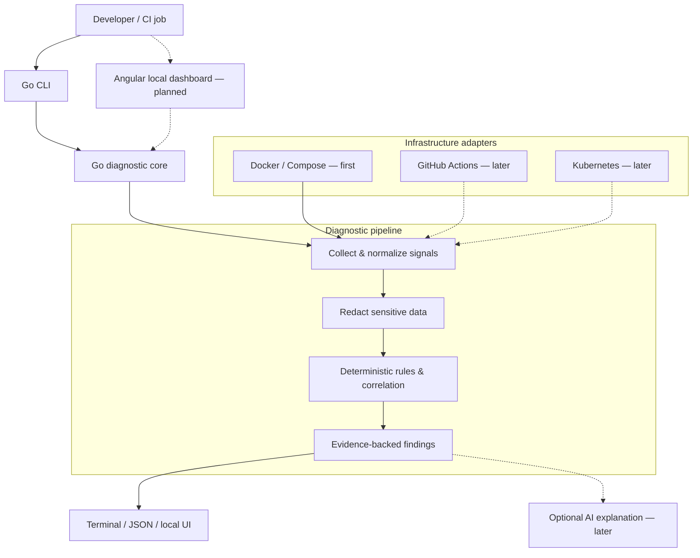

<div align="center">

# 🩺 StackMedic

### Debug the stack. Trust the diagnosis. Ship the fix.

**A local-first, open-source DevOps diagnostic toolkit for finding why application stacks fail — with evidence-backed findings, actionable guidance, and a path to verified remediation.**

[](#project-status)
[](#scope-and-roadmap)
[](#architecture)
[](#architecture)

[The problem](#the-problem) · [Example](#what-the-experience-should-look-like) · [Roadmap](#scope-and-roadmap) · [Architecture](#architecture) · [Contribute](#contributing)

</div>

## Project status

> [!IMPORTANT]
> **Project status: pre-alpha / under development.** This README is the public product specification for StackMedic. The commands, reports, and architecture below describe **intended behavior**, not features that are already released. There is no installable version yet. The goal is to ship a small, reliable Docker Compose diagnostic CLI before expanding the scope.

## The problem

An application fails. The API keeps restarting. The database looks healthy. CI is red. Your team jumps between container logs, YAML files, dashboards, and issue threads — hoping to find the one detail that explains everything.

Most tools answer **“What is happening?”** StackMedic aims to help answer:

- **What broke?** Identify unhealthy services and failed dependencies.
- **Why might it have broken?** Correlate configuration, runtime state, and logs.
- **What evidence supports that diagnosis?** Show the exact signals behind each finding.
- **What should I try next?** Recommend the smallest safe remediation and a way to verify it.

**The goal: turn a confusing failure into a reproducible, explainable diagnosis — starting with a single local command.**

## What makes StackMedic different?

| Principle | What it means |
| --- | --- |
| **Evidence before explanations** | Findings link to relevant logs, configuration, health checks, and dependency state. |
| **Useful without AI** | Deterministic rules produce the core diagnosis; AI assistance is optional and never required. |
| **Local-first** | The initial workflow runs against your local Docker environment without a cloud account. |
| **Safe by default** | Diagnosis is read-only; no automatic changes to workloads, credentials, or infrastructure. |
| **Actionable results** | Each supported finding includes a recommended next step and a suggested verification check. |
| **Built to extend** | Versioned diagnostics and adapters will allow contributors to cover new failure patterns. |

StackMedic is **not** intended to replace observability systems such as Prometheus or Grafana. It is the troubleshooting layer that helps a developer make sense of signals already available.

## What the experience should look like

**Illustrative preview — the command and output below are not implemented yet.**

```bash
stackmedic diagnose --file compose.yaml
```

```text
  🩺 StackMedic · Local diagnosis
  ───────────────────────────────────────────────────
  Target       compose.yaml
  Services     3 discovered
  Health       2 healthy · 1 unhealthy

  HIGH  SM-COMPOSE-001 · API cannot resolve database host

  Affected     api
  Suspected    DATABASE_HOST points to "database", but the
               Compose database service is named "postgres".

  Evidence     • api log: lookup database: no such host
               • api environment: DATABASE_HOST=database
               • Compose service key: postgres

  Try next     Change DATABASE_HOST to "postgres".
  Verify       Restart the affected service, then check
               its health endpoint and connection logs.

  Summary      1 finding · 0 changes applied
```

The proposed JSON output would let developers attach diagnostics to CI artifacts or build integrations:

```bash
stackmedic diagnose --file compose.yaml --format json > diagnosis.json
```

A representative **draft** finding format (subject to change before the first release):

```json
{
  "id": "finding-001",
  "rule_id": "SM-COMPOSE-001",
  "severity": "high",
  "resource": "compose://api",
  "summary": "API cannot resolve database host",
  "evidence": [
    { "source": "container_log", "message": "lookup database: no such host" },
    { "source": "compose_config", "message": "DATABASE_HOST=database" },
    { "source": "compose_config", "message": "service=postgres" }
  ],
  "recommendation": "Set DATABASE_HOST to postgres",
  "verification": "Check API health and database connection logs",
  "changes_applied": false
}
```

> [!NOTE]
> A finding is a **supported hypothesis**, not a guarantee. When the evidence is ambiguous, StackMedic should say so rather than manufacture certainty.

## Scope and roadmap

**One excellent workflow first:** diagnose a broken Docker Compose application on a developer machine.

| Phase | Planned deliverables | Status |
| --- | --- | --- |
| **v0.1 — Diagnose locally** | Go CLI, Compose file validation, Docker health/restart checks, log correlation, common failure rules, human-readable + JSON reports, fixture-based tests | 🟡 Planned |
| **v0.2 — Explain visually** | Local Angular dashboard, dependency graph, finding details, incident history, exportable reports | ⚪ Planned |
| **v0.3 — Diagnose CI** | GitHub Actions adapter, failed-job/log analysis, bounded permissions, CI-friendly output | ⚪ Planned |
| **v0.4 — Kubernetes** | Read-only pod/event/configuration diagnostics, RBAC-aware access, K8s failure rules | ⚪ Planned |
| **Later — Intelligence & ecosystem** | Optional LLM explanations, MCP integration, community diagnostic packs, reviewed remediation workflows | ⚪ Research / future |

### First diagnostic rules to build

- Container crash loops and non-zero exits
- Unhealthy services and failing health checks
- Missing or malformed environment configuration
- Wrong Compose service names and broken DNS references
- Port collisions and unreachable mapped ports
- Invalid bind mounts and missing expected files
- Startup dependency / readiness failures
- Database connection errors with matching configuration evidence
- Resource pressure signals available from Docker
- Misconfigured service-to-service connectivity

Rules must be testable against **reproducible broken-stack fixtures**. New integrations should not ship before the existing checks are trustworthy.

### Non-goals for the MVP

- Managing production clusters or replacing an infrastructure platform
- Replacing monitoring, alerting, tracing, or log storage
- Automatically executing suggested fixes
- Requiring a hosted SaaS account, Kubernetes cluster, or paid LLM
- Claiming definitive root cause when signals do not justify it

## Architecture

StackMedic is designed as a **modular monolith**: a Go diagnostic core, a CLI entry point, and an optional local web dashboard. Adapters gather signals; rules evaluate them; reporters present evidence and next steps.



### Proposed technology choices

| Layer | Choice | Rationale |
| --- | --- | --- |
| Diagnostic engine + CLI | **Go** | Portable binaries, concurrency, strong systems tooling ecosystem |
| Web dashboard | **Angular + TypeScript** | Rich incident and dependency visualizations |
| Local history | **SQLite** | Lightweight, zero-server local persistence when needed |
| First data source | **Docker Engine + Docker Compose** | Easy to reproduce and valuable in everyday development |
| Later adapters | **GitHub Actions, Kubernetes** | Broaden coverage without expanding the initial core |
| Optional AI | **Provider-neutral integration** | Explanation only with user consent; diagnostics must work offline |
| Testing | **Go tests + failure fixtures + integration tests** | Reproduce every supported diagnosis before publishing a rule |

### Extensibility contract (design target)

The core concepts are deliberately small:

1. **Collector** — gathers a bounded set of signals from an authorized target.
2. **Normalizer** — converts signals into a stable, redacted internal format.
3. **Rule** — evaluates signals and emits evidence-backed findings.
4. **Reporter** — renders terminal, JSON, and eventually UI output.
5. **Verifier** — suggests or performs read-only checks to confirm whether a user-applied fix worked.

Contributor-facing extension points should be **versioned and documented** before being declared stable. External plugins will not be required for v0.1.

## Security and privacy by design

A diagnostics tool can encounter production secrets and privileged infrastructure. These protections are product requirements, not optional improvements.

- **Read-only first:** no automatic restart, deletion, patching, or secret rotation.
- **Least privilege:** request only access necessary for the selected diagnostic operation. Docker socket access is highly privileged and should never be treated as inherently safe.
- **Secret redaction:** avoid exposing tokens, passwords, connection strings, and sensitive environment values in generated reports.
- **Explicit data boundaries:** no telemetry or log upload by default. Any external AI request must be an explicit opt-in with a clear view of the data being sent.
- **Untrusted input handling:** never blindly execute commands extracted from logs, configuration, issues, or AI output.
- **Human-approved remediation:** if repair execution is ever introduced, start with previewable changes, confirmation, auditability, and rollback considerations.
- **Clear uncertainty:** report limitations when data is incomplete or insufficient for a reliable diagnosis.

Security reporting instructions and a disclosure contact will be published in `SECURITY.md` before the first public release. **Do not post security-sensitive details or credentials in public issues.**

## Installation and development

**Not yet available.** There are no supported binaries, packages, or install scripts at this stage. Please do not mistake the preview commands in this README for working installation instructions.

The first public development release will include:

- Documented prerequisites and local setup
- Reproducible broken Compose samples
- Automated checks and build instructions
- Linux, macOS, and Windows build information
- Signed or checksum-verifiable release artifacts where supported

Until then, the highest-value contributions are design feedback, diagnostic rule proposals, failure fixtures, documentation, and early implementation once the initial code is published.

## Contributing

StackMedic is intended to become a **community-built diagnostics toolbox**. You do not need to be a Go expert to help.

Good first contribution areas include:

| Area | Example contribution |
| --- | --- |
| Diagnostics | Propose a real Docker Compose failure with sanitized logs and an expected finding |
| Tests | Add a reproducible fixture that demonstrates a failure and its successful verification |
| Go | Implement a collector, rule, or JSON reporting behavior with tests |
| Angular | Help design the eventual findings view, service graph, or accessible components |
| Documentation | Improve examples, troubleshooting explanations, and onboarding |
| Security | Review permissions, redaction cases, and unsafe remediation edge cases |

**Before opening a pull request:**

1. Search existing issues to avoid duplicating work.
2. Describe the problem, minimal reproduction, and expected behavior.
3. Keep changes focused; add a failing fixture or test for diagnostic behavior.
4. Remove secrets and personal data from logs, screenshots, and examples.
5. Explain relevant security and compatibility implications.

As the repository develops, formal contribution guidance, issue labels such as `good first issue` and `help wanted`, and a code of conduct will be added.

## Project values

**Reliability over hype.** A small tool that correctly diagnoses five common failures is more useful than a flashy dashboard that guesses at fifty.

**Transparency over magic.** Developers should be able to inspect every finding and reproduce its reasoning.

**Community over lock-in.** The core should remain useful locally, with open formats and no required hosted service.

## Frequently asked questions

<details>
<summary><strong>Is StackMedic an AI agent?</strong></summary>

Not at its core. The initial product uses deterministic diagnostics and evidence correlation. Optional AI explanations and MCP support are later-stage integrations, not prerequisites for useful results.

</details>

<details>
<summary><strong>Will StackMedic fix my infrastructure automatically?</strong></summary>

Not in the MVP. It will report findings, recommend safe next steps, and suggest ways to verify a user-applied fix. Any future change-execution capability will need explicit user approval and strong safeguards.

</details>

<details>
<summary><strong>Why start with Docker Compose instead of Kubernetes?</strong></summary>

Compose is easier to reproduce locally and allows the diagnostic engine, report format, rule tests, and security model to mature before expanding into complex cluster environments.

</details>

<details>
<summary><strong>Can I use StackMedic without sharing my logs with an AI provider?</strong></summary>

That is a core design requirement. The first release is intended to work locally without any AI provider. If AI integrations are added later, external sharing must be optional and explicit.

</details>

## License

**Apache License 2.0 is the proposed license.** The repository must include an actual `LICENSE` file before the project is published as open source or begins accepting outside code contributions. This README alone does **not** grant an open-source license.

---

<div align="center">

### When something breaks, start with evidence.

**StackMedic** — diagnose, understand, verify.

*Early-stage project. Interested in building it? Contribute a reproducible failure case or help shape the first diagnostic rules.*

</div>
